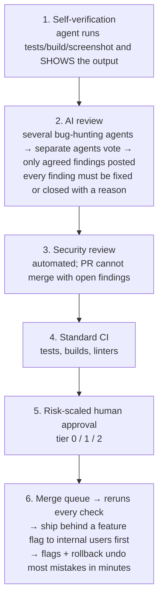

# The Blueprint

Based on [David Shapiro's video](https://www.youtube.com/watch?v=VmrNsOVOAt4), which walks through how Anthropic's Claude Code team reviews code. See the [README](README.md) for full credit.

---

## 0. The core shift

- **Old question:** Did a human read the code?
- **New question:** Which check, automated or human, is the right one to catch what could go wrong here?

The scarce resource is no longer code. It is **human attention**. Everything below is about spending that attention only where it matters.

**Goal:** most pull requests merge with **at most one human in the loop** (who may be the author).

**Guardrail:** if reverts or incidents go up, you saved nothing. You only moved human time from reviewing to cleaning up.

> Reported result at Anthropic (June to September 2026, self-reported): merged PRs into Claude Code more than doubled while the share of changes that had to be reverted fell by more than 40%.

---

## 1. The verification stack

Every change passes through layers. Each layer catches some problems and misses others; together they catch most.



### Layer 1: Verify before anyone looks
Give the agent something it can **run**: tests, a build, a screenshot to compare with the design. Require it to **show the output**, not just say "done". (Anthropic's estimate: this alone makes results 2-3x better.)

### Layer 2: AI review with a quorum
- Several reviewer agents hunt for bugs in parallel.
- A separate group votes on each finding; only findings with enough agreement are posted. This keeps noise down.
- **Every posted finding needs a response:** fixed, or closed with a reason.
- Reported effect: share of PRs that received substantive review comments went from 16% to 54%.

### Layer 3: Automated security review
Blocking. A PR with an open security finding does not merge.

### Layer 4: The usual CI
Tests, builds, type checks, linters.

### Layer 5: Human approval scaled by risk
See [Risk tiers](#2-risk-tiers). The **change** sets the tier, not the author.

### Layer 6: Merge queue, flags, staged rollout
- The merge queue reruns every check against the latest main.
- New behaviour ships behind a feature flag, to internal users first.
- If something still breaks, flip the flag or roll back. Minutes, not days.

### The review-loop limit
A coding agent and a reviewer agent can keep each other busy forever (one PR at Anthropic went 50+ rounds overnight). **After 3 review rounds, the reviewer stops posting findings and asks the author to step back and rethink the approach.** With this and a few similar changes, single-round pass rate went from 65% to 78%.

### The reviewer improves itself
**Every past incident becomes a test case.** Score the AI reviewer against all of them every day. Start with your worst outage ever: nobody else has your incidents, so nobody else can build this test set. Template: [incident-to-test.md](templates/incident-to-test.md).

---

## 2. Risk tiers

| Tier | Example | Human approvals needed |
|---|---|---|
| **0: Low risk** | Docs fix, typo, comment, non-shipped config | **0**, once automated checks pass, *if the author is trusted* |
| **1: Ordinary** | Normal product change | **1** |
| **2: High risk** | Auth, payments, data migrations, security, infra, anything hard to reverse | **2** |

Template: [risk-tiers.yml](templates/risk-tiers.yml). Start strict and loosen only on evidence.

---

## 3. The two non-negotiable rules

Copy these first.

1. **An agent's approval never counts as a human's approval.**
2. **Whoever prompted the agent owns the change**, exactly as if they had typed it themselves.

A person is accountable for every change that ships, whoever typed it.

> Note from the video: not everyone agrees. Since September 2026 GitHub lets companies count Copilot's approval toward required approvals. If you are regulated, be careful: most compliance rules don't require a human to read every line, but most do require someone to approve each change.

---

## 4. Build the floor before you open the firehose

You can only loosen human review if almost everything is **reversible**. The floor has four planks:

1. **Tests an agent can run** (locally, without a human setting anything up)
2. **Feature flags**
3. **Staged releases** (internal → small % → everyone)
4. **Fast rollback**

> Google's 2025 DORA research (as cited in the video): only about 21% of teams could recover from a failed deployment in under an hour.

**If you can't undo a mistake quickly, you can't afford to review less.** Start strict; loosen only when the evidence supports it. Checklist: [readiness-checklist.md](templates/readiness-checklist.md).

---

## 5. Where the humans go

AI is a bottleneck-shifting machine: speed up writing and the bottleneck moves to reading. (Faros AI's 2025 study of 10,000+ developers, cited in the video: heavy-AI teams merged 98% more PRs but review time rose 91%.) Build for the new bottleneck.

**Upstream:**
- Deciding whether to build something at all
- Specifying it precisely enough that a machine can check the result

**Downstream:**
- Designing the checks
- Deciding which code is too risky to leave to machines alone
- Deciding which designs will set a pattern for everyone else
- Judging whether the evidence really holds up
- Owning the risk

**Rule of thumb:** when the same review comment has come up a hundred times, it shouldn't be a review anymore. Make it a rule, a test or a tool. Don't pull senior engineers out of deep work to catch routine mistakes.

---

## 6. The org model

Bolting agents onto the old structure (one person supervising agents and reading everything they produce) just moves the production queue from typing to reading. It's a stepping stone.

**End state:** machines do the work, supervision, coordination and most auditing. People hold what machines can't: **purpose, trust and accountability.**

```
audit       [safety agent]   [security agent]
coordinate          [coordinator]
manage        [manager]        [manager]
supervise   [sup] [sup]      [sup] [sup]
work        [w][w][w][w]     [w][w][w][w]
```

### Leadership's three jobs
1. **Map every kind of decision by how much human attention it needs:**
   - No human
   - Human **on** the loop (watches, can step in)
   - Human **in** the loop (approves each step)
   - Licensed signature (doctor, engineer, auditor)
   Risk tiers are an early version of this map.
2. **Automate coordination before you cut coordinators.** Coordination is one of the biggest bottlenecks in any company.
3. **Keep a human on the hook.** The two rules in section 3.

Measure managers by **span of accountability** (how much of the work they can answer for), not span of control (how many people report to them).

---

## 7. This isn't new

We never made systems reliable by having a person inspect every step. We made them reliable by having machines check machines, and people design the checks:

- Databases write every change to a log, replay it on a standby, and watch it for anomalies.
- TCP checksums every packet and resends damaged ones.
- ECC memory fixes flipped bits on its own.
- Double-entry bookkeeping (500+ years old) records every transaction twice so the books must balance.
- Shannon (1948): you can send a message reliably over a noisy channel if you add the right redundancy.

The next step is the business stack (finance, operations, compliance) following the technical stack. Not a world without checks: a world with more checks than ever, almost all automatic.

---

## Caveats (from the video)

- The numbers are Anthropic grading its own homework; nobody has verified them independently.
- Anthropic spends far more on tokens than most businesses would.
- Copy the **principles** (layers, tiers, two rules, the floor), not the exact token budget.
