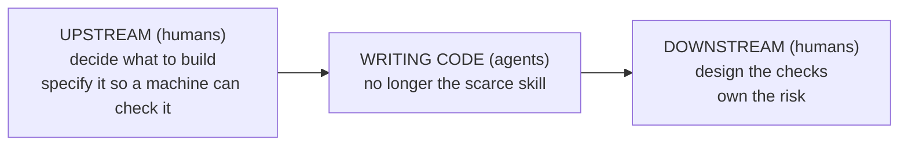
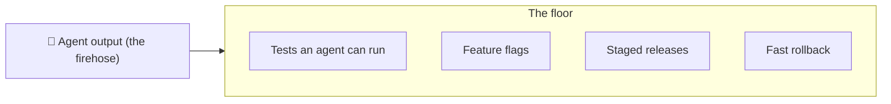
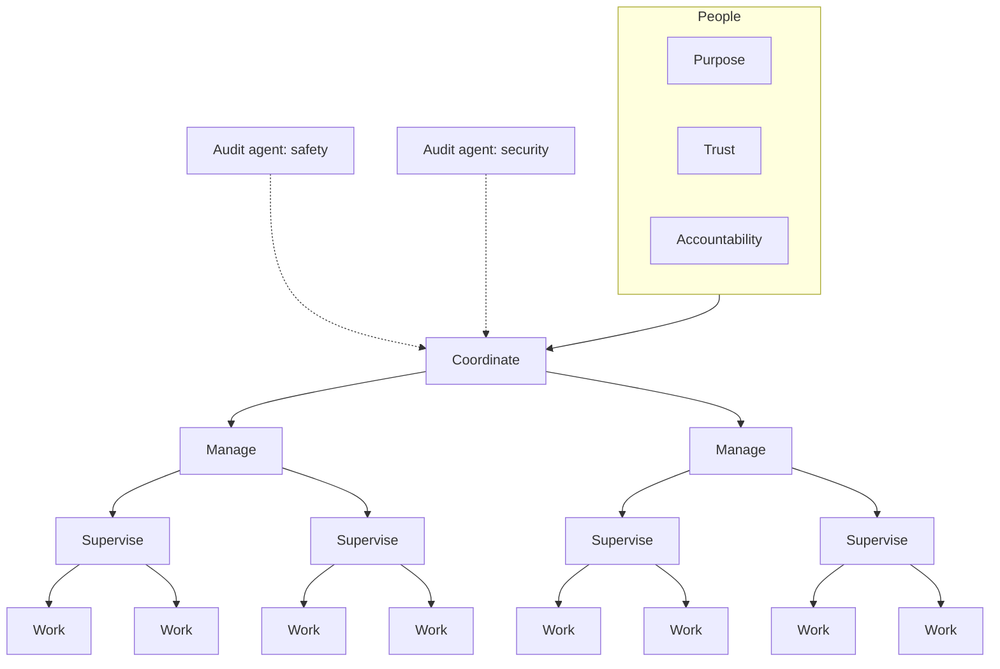
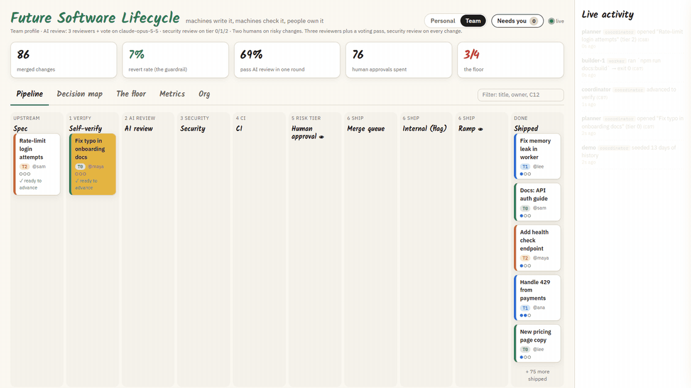
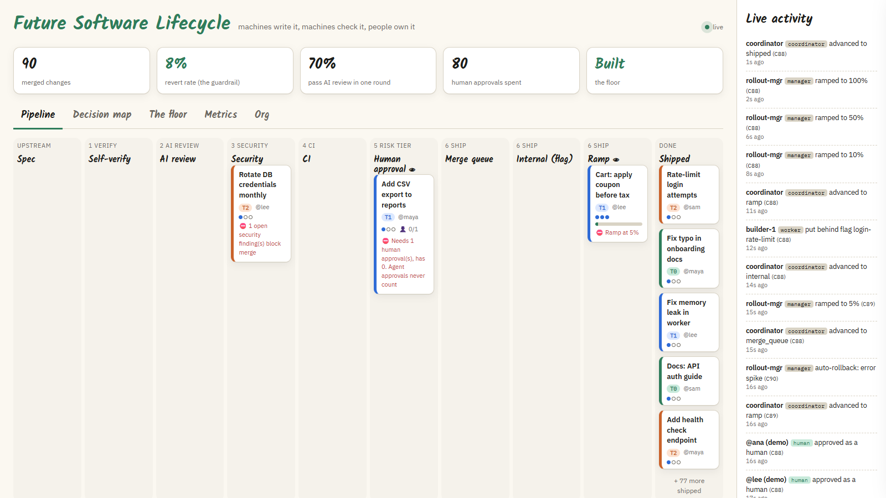
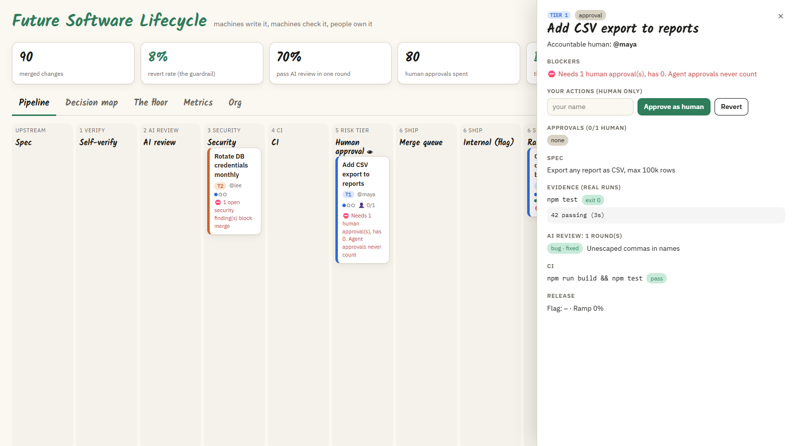
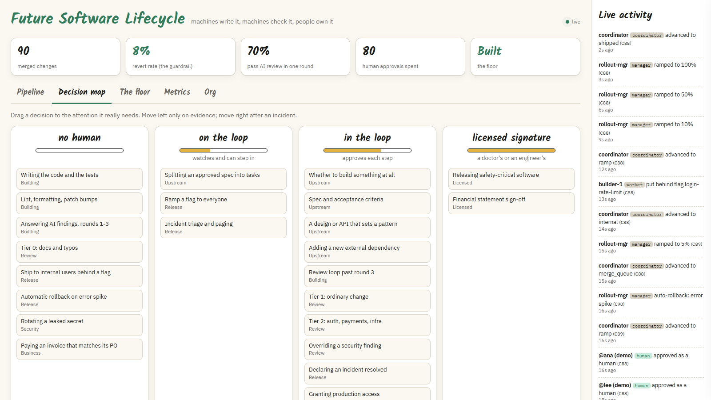
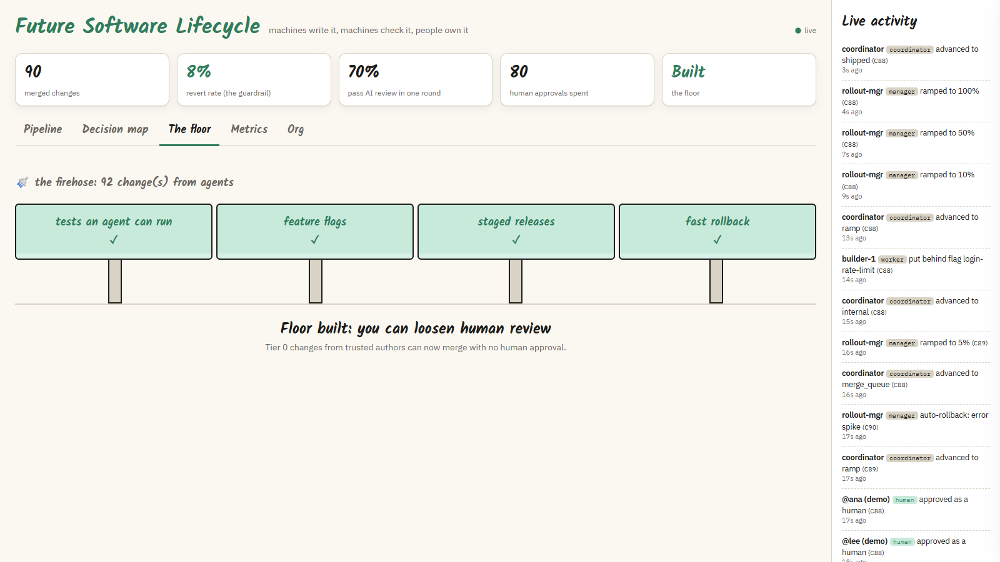
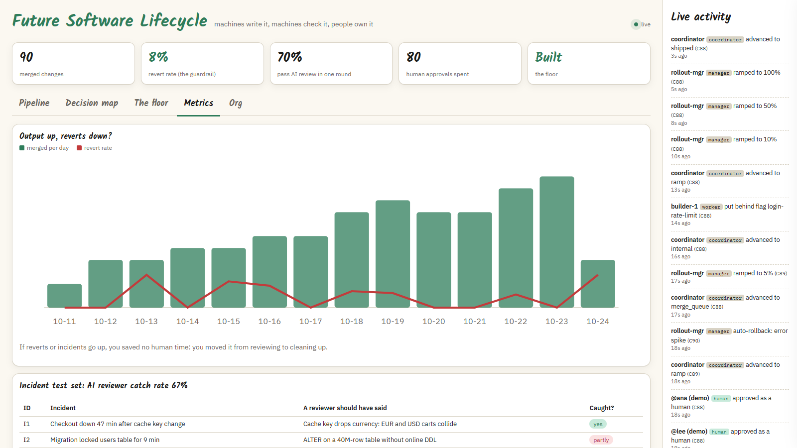
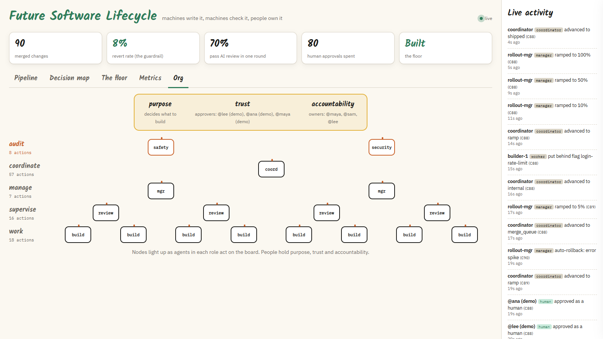

# Future Software Lifecycle

A copyable blueprint for running software development when AI agents write most of the code.

Humans can no longer read every line. So instead of asking *"did a human read this?"*, this blueprint asks *"which check, automated or human, is the right one to catch what could go wrong?"*, and builds the system around that question.

## Credit

This blueprint is based on the ideas in **David Shapiro's** video:

**[▶ Watch the video on YouTube](https://www.youtube.com/watch?v=VmrNsOVOAt4)**

The video breaks down Anthropic's October 2026 post on how the Claude Code team reviews its own code (where Claude writes about 90% of the code), and connects it to much older ideas: database write-ahead logs, TCP checksums, error-correcting memory, double-entry bookkeeping and Shannon's information theory. Watch it; it explains the *why* far better than a README can.

All the ideas belong to David Shapiro and Anthropic. This repo only turns them into a checklist-and-templates kit anyone can copy. Numbers quoted here are Anthropic's own, reported in the video, and have not been independently verified.

## The idea in three pictures

**1. Writing code is no longer the scarce skill. Human attention is.**



**2. Build the floor before you open the firehose.** You can only loosen human review when almost everything is reversible.



**3. The end state: machines do the work, people hold what machines can't.**



## The board: run the blueprint with Claude Code

The blueprint is also a working tool. **Claude Code does the work through a CLI; you watch and decide in a live dashboard.** Every step it takes (tests run, findings, fixes, approvals, ramps) moves a card across the board in real time.



*A simulated team of agents (`node lifecycle/demo.mjs`): a typo fix waits for the floor to be built before it can skip human review, a login change needs two human approvals, a coupon change hits the 3-round review limit and gets rethought, and a caching change is halted mid-ramp and rolled back.*

### What each view is for

| | |
|---|---|
|  | **Pipeline.** Every change moves through the six layers. Each card shows its risk tier, the human who owns it, AI review rounds (red after 3) and the exact thing blocking it. The live feed on the right shows who did what. |
|  | **Human approval.** Click a card to see the real test output, every finding and how it was answered. Only a person in the GUI can approve: agent approvals are shown crossed out because they never count. |
|  | **Decision map.** Drag each kind of decision to the attention it needs: no human, on the loop, in the loop, or licensed signature. |
|  | **The floor.** The four planks. Until all four exist, every change needs at least one human, even tier 0. |
|  | **Metrics.** Output vs revert rate (the guardrail) and how often the AI reviewer catches your past incidents. |
|  | **Org.** The end-state org chart. Nodes light up as agents in each role act; people hold purpose, trust and accountability. |

### Quick start

Needs [Node.js](https://nodejs.org) 18 or newer. The board and CLI have no dependencies.

```bash
git clone https://github.com/CurioCrafter/future-software-lifecycle
cd future-software-lifecycle
node lifecycle/server.mjs --dir .lifecycle-demo
```

Open http://localhost:4317, then in a second terminal watch a simulated team:

```bash
node lifecycle/demo.mjs --dir .lifecycle-demo
```

To use it on your own project, copy the `lifecycle/` folder and `.claude/skills/lifecycle/` into your repo, run `node lifecycle/cli.mjs init`, and start the server without `--dir`.

### Two ways to drive it

**1. Claude subscription (Claude Code, no extra cost).** The repo ships a Claude Code skill at [.claude/skills/lifecycle/SKILL.md](.claude/skills/lifecycle/SKILL.md). Claude Code picks it up automatically in this folder. You prompt each part and Claude does that stage, records it on the board, and stops:

| You say | Claude does |
|---|---|
| "Open a lifecycle change for adding CSV export. I own it." | Writes the spec and acceptance criteria, picks the risk tier, opens card C1 |
| "Build it and self-verify." | Makes the change, runs your tests through `cli.mjs evidence` so the real output is recorded |
| "Run the AI review round." | Reviews the diff (or spawns reviewer subagents that vote), records findings, fixes or closes each |
| "Security review and CI." | Records security findings (they block merge), runs your full check |
| "What's blocking C1?" | Reads the board. At approval it tells you to click Approve in the GUI: it cannot approve for you |
| "Ship it behind a flag and ramp." | Flags it, ramps 10% → 50% → 100%. You can halt the ramp from the GUI at any time |

**2. Claude API (pay per token, automated).** [lifecycle/autopilot.mjs](lifecycle/autopilot.mjs) runs layers 2 and 3 on your own API key: several reviewers hunt for bugs in parallel, a separate voting pass keeps only the findings most of them agree on, and a security reviewer runs last. Results land on the board. It never approves and never merges.

```bash
cd lifecycle && npm install && cd ..
export ANTHROPIC_API_KEY=sk-ant-...
node lifecycle/autopilot.mjs C1 --base main --test "npm test"
```

Set `LIFECYCLE_MODEL=claude-sonnet-5-5` for a cheaper model (default `claude-opus-5-5`). Each round costs a few API calls per reviewer, so cost grows with diff size and `--reviewers`.

### What the board enforces

- Agent approvals never count. Human approvals only come from the GUI.
- A change can't leave self-verify without a real, passing command run.
- Every finding must be fixed or closed with a reason. Open security findings block merge.
- After 3 AI review rounds, the change is blocked until the approach is rethought.
- Tier 0 skips human review only when the floor is fully built and the author is trusted.
- The merge queue re-checks every earlier gate before release.

The board is a local process guard, not a security boundary: anything that can write `.lifecycle/state.json` can change it. Real enforcement belongs in branch protection and your CI. Use the board to run and see the process.

## What's in this repo

| File | What it's for |
|---|---|
| [lifecycle/](lifecycle/) | The board: `server.mjs` (dashboard), `cli.mjs` (what Claude uses), `autopilot.mjs` (API mode), `demo.mjs`, `test.mjs`. |
| [.claude/skills/lifecycle/SKILL.md](.claude/skills/lifecycle/SKILL.md) | The Claude Code skill that teaches Claude to run each stage through the CLI. |
| [BLUEPRINT.md](BLUEPRINT.md) | The full playbook: the six verification layers, risk tiers, the two non-negotiable rules, the floor, and the org model. |
| [templates/decision-map.md](templates/decision-map.md) | Map every decision to no human / on the loop / in the loop / licensed signature. |
| [templates/readiness-checklist.md](templates/readiness-checklist.md) | Score your team before you loosen review. Start here. |
| [templates/risk-tiers.yml](templates/risk-tiers.yml) | Copy and edit: which paths/changes need 0, 1 or 2 human approvals. |
| [templates/AGENTS.md](templates/AGENTS.md) | Rules to drop into your repo for coding agents (verify before claiming done, review loop limit, ownership). |
| [templates/pull_request_template.md](templates/pull_request_template.md) | PR template: evidence, risk tier, accountable human, rollback plan. |
| [templates/incident-to-test.md](templates/incident-to-test.md) | Turn every past incident into a test your AI reviewer is scored on daily. |

## How to adopt it

1. Fill in the [readiness checklist](templates/readiness-checklist.md). If you can't roll back a bad deploy in under an hour, **stop there and build the floor first.**
2. Copy `templates/AGENTS.md` and `templates/pull_request_template.md` into your repo (`.github/pull_request_template.md`).
3. Write your `risk-tiers.yml`. Start strict: everything is tier 2 until the evidence says otherwise.
4. Track two numbers weekly: **merged PRs** and **revert/incident rate**. Loosen a tier only when output goes up *and* reverts don't.

## License

Docs and templates: [CC BY 4.0](LICENSE). Copy, adapt and share, including commercially, as long as you credit this repo and David Shapiro's video. Code in `lifecycle/`: [MIT](lifecycle/LICENSE).

This is a community project. It is not made or endorsed by Anthropic or David Shapiro.
