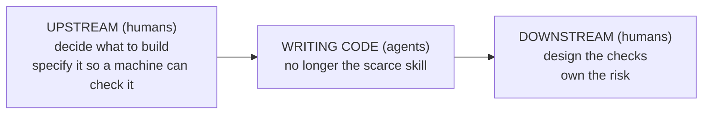
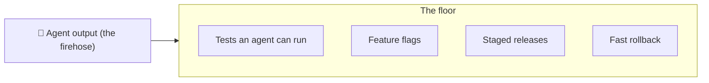
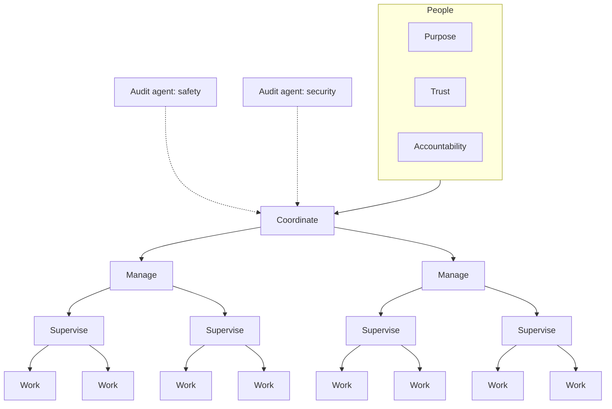

# Future Software Lifecycle

A copyable blueprint for running software development when AI agents write most of the code.

Humans can no longer read every line. So instead of asking *"did a human read this?"*, this blueprint asks *"which check, automated or human, is the right one to catch what could go wrong?"*, and builds the system around that question.

## Credit

This blueprint is based on the ideas in **David Shapiro's** video:

**[▶ Watch the video on YouTube](https://www.youtube.com/watch?v=VmrNsOVOAt4)**

The video breaks down Anthropic's October 2026 post on how the Claude Code team reviews its own code (where Claude writes about 90% of the code), and connects it to much older ideas: database write-ahead logs, TCP checksums, error-correcting memory, double-entry bookkeeping and Shannon's information theory. Watch it; it explains the *why* far better than a README can.

All the ideas belong to David Shapiro and Anthropic. This repo only turns them into a checklist-and-templates kit anyone can copy. Numbers quoted here are Anthropic's own, reported in the video, and have not been independently verified.

## The idea in three pictures

**1. Writing code is no longer the scarce skill. Human attention is.**

**2. Build the floor before you open the firehose.** You can only loosen human review when almost everything is reversible.

**3. The end state: machines do the work, people hold what machines can't.**

## What's in this repo

| File | What it's for |
|---|---|
| [BLUEPRINT.md](BLUEPRINT.md) | The full playbook: the six verification layers, risk tiers, the two non-negotiable rules, the floor, and the org model. |
| [templates/readiness-checklist.md](templates/readiness-checklist.md) | Score your team before you loosen review. Start here. |
| [templates/risk-tiers.yml](templates/risk-tiers.yml) | Copy and edit: which paths/changes need 0, 1 or 2 human approvals. |
| [templates/AGENTS.md](templates/AGENTS.md) | Rules to drop into your repo for coding agents (verify before claiming done, review loop limit, ownership). |
| [templates/pull_request_template.md](templates/pull_request_template.md) | PR template: evidence, risk tier, accountable human, rollback plan. |
| [templates/incident-to-test.md](templates/incident-to-test.md) | Turn every past incident into a test your AI reviewer is scored on daily. |

## How to adopt it

1. Fill in the [readiness checklist](templates/readiness-checklist.md). If you can't roll back a bad deploy in under an hour, **stop there and build the floor first.**
2. Copy `templates/AGENTS.md` and `templates/pull_request_template.md` into your repo (`.github/pull_request_template.md`).
3. Write your `risk-tiers.yml`. Start strict: everything is tier 2 until the evidence says otherwise.
4. Track two numbers weekly: **merged PRs** and **revert/incident rate**. Loosen a tier only when output goes up *and* reverts don't.

## License

[CC BY 4.0](LICENSE): copy, adapt and share, including commercially, as long as you credit this repo and David Shapiro's video.
