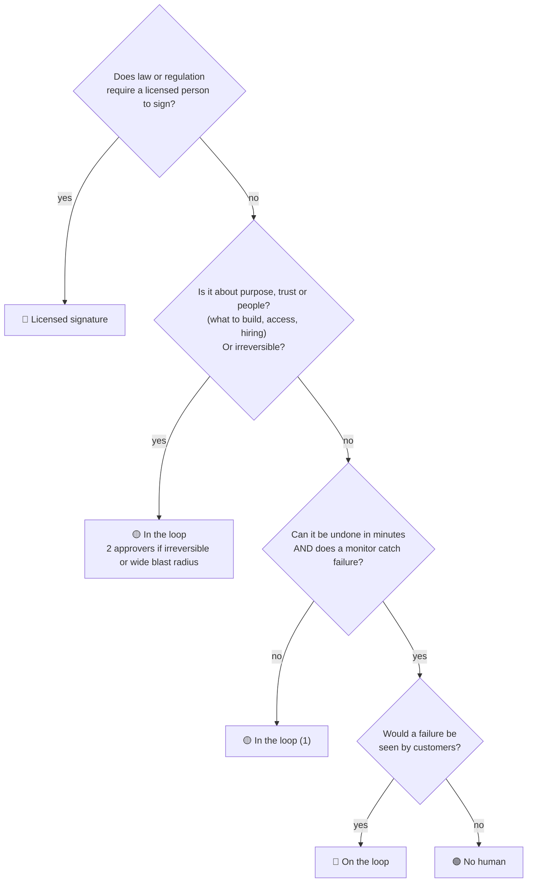

# Decision map

Leadership's first job: map **every** kind of decision to the human attention it actually needs. Spend attention only where it buys something.

```
NO HUMAN            ON THE LOOP            IN THE LOOP             LICENSED SIGNATURE
attention: ░░░░     attention: ██░░        attention: ███░         attention: ████
machines decide     watches, can step in   approves each step      a doctor's, engineer's,
and log it          (alerts, halt button)  (1 or 2 approvers)      auditor's or lawyer's
```

Risk tiers are the code-review slice of this map: **tier 0 = no human, tier 1 = in the loop (1), tier 2 = in the loop (2).**

## How to place a decision



## The map

### Upstream: deciding what to build
| Decision | Level | Why |
|---|---|---|
| Whether to build something at all | 🟡 In the loop | Purpose. Machines can't own it. |
| Priority order of the backlog | 🟡 In the loop | Purpose. |
| Spec and acceptance criteria (agent drafts) | 🟡 In the loop (1) | The spec is what the machine checks against. A bad spec passes every test. |
| Splitting an approved spec into tasks | 🔵 On the loop | Cheap to redo. |
| A design or API that sets a pattern for others | 🟡 In the loop (2) | Hard to reverse once copied. |
| Adding a new external dependency | 🟡 In the loop (2) | Supply-chain risk, hard to remove later. |

### Building
| Decision | Level | Why |
|---|---|---|
| Writing the code and the tests | 🟢 No human | Agents write; the prompter still owns it. |
| Lint, formatting, patch-version bumps with green CI | 🟢 No human | Fully covered by checks. |
| Answering AI review findings, rounds 1-3 | 🟢 No human | Agent fixes or closes with a reason. |
| Review loop past round 3 | 🟡 In the loop (1) | Author rethinks the approach. |

### Review and merge
| Decision | Level | Why |
|---|---|---|
| Tier 0: docs, typos, comments (trusted author) | 🟢 No human | Checks are enough. |
| Tier 1: ordinary product change | 🟡 In the loop (1) | One human, can be the author. |
| Tier 2: auth, payments, migrations, infra, security | 🟡 In the loop (2) | Highest blast radius. |
| Overriding a blocking security finding | 🟡 In the loop (2) | Never automatic. |
| Merge queue order and re-running checks | 🟢 No human | Mechanical. |

### Release and operations
| Decision | Level | Why |
|---|---|---|
| Ship behind a flag to internal users | 🟢 No human | Reversible in minutes, no customers. |
| Ramp a flag internal → % → everyone, gated on metrics | 🔵 On the loop | Customers see it; human can halt. |
| Automatic rollback on an error spike | 🟢 No human | Speed beats permission. Notify after. |
| Incident triage and paging | 🔵 On the loop | Agent triages; human paged by severity. |
| Declaring an incident resolved, the postmortem | 🟡 In the loop (1) | Accountability. |
| Turning the incident into a reviewer test case | 🔵 On the loop | Agent drafts, human glances. |

### Security
| Decision | Level | Why |
|---|---|---|
| Alert triage | 🔵 On the loop | Agents already do this around the clock. |
| Rotating a leaked secret | 🟢 No human, then notify | Every minute counts. |
| Granting production access or permissions | 🟡 In the loop (2) | Trust. |
| Publicly disclosing a vulnerability | 🟡 In the loop (2) | Trust, legal exposure. |

### Data
| Decision | Level | Why |
|---|---|---|
| Irreversible data deletion or migration | 🟡 In the loop (2) | Can't roll back. |
| Using personal data in a new way | 🟡 In the loop (2) | Trust, privacy law. |

### Business stack
| Decision | Level | Why |
|---|---|---|
| Paying an invoice that matches its PO and receipt | 🟢 No human | Three-way match is a machine check. |
| Payment above threshold or not matching | 🟡 In the loop (1) | Money out the door. |
| Ledger reconciliation | 🔵 On the loop | Machines balance; humans see exceptions. |
| Changing prices or customer terms | 🟡 In the loop (2) | Trust with customers. |
| Hiring, firing, performance ratings | 🟡 In the loop (2) | About people. Never automate. |

### Licensed signature (if your field has it)
| Decision | Who signs |
|---|---|
| Releasing safety-critical software (medical devices, aviation, automotive) | Qualified/licensed engineer per your standard |
| Clinical decisions made or shown by health software | Licensed clinician |
| Structural or safety engineering calculations | Licensed professional engineer |
| Financial statements, internal-control sign-off | CPA / auditor, officers where the law requires it |
| Contracts, terms of service, regulatory filings | Lawyer / authorized officer |

## Rules for the map

1. **Every row has a named owner, even "no human" rows.** Someone owns the automation and answers for it.
2. **An agent's approval never counts as a human's,** at any level.
3. **Move a decision left (less attention) only on evidence:** output went up and reverts/incidents didn't.
4. **Move it right after an incident** it caused, until the evidence says otherwise.
5. **Start strict.** New kinds of decisions start one level to the right of where you think they belong.

## Your map

Copy this table and fill in your company's decisions.

| Decision | Level | Owner | Evidence for this level | Last reviewed |
|---|---|---|---|---|
| | | | | |
